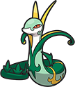
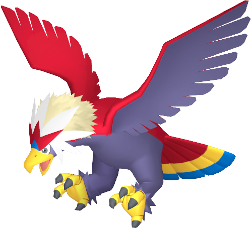
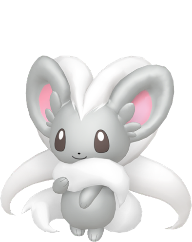
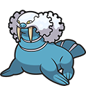
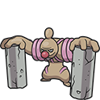
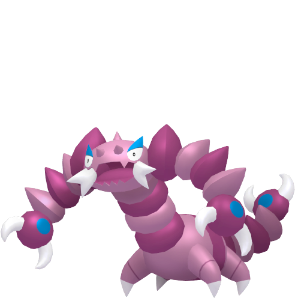

# Pokémon White 2 Team

---

## Serperior (Aconyte)

  

### Moves

- Energy Ball (TM - Aspertia City - Req. Surf)
- Cut  
- Aerial Ace (TM - Mistralton Runway)
- Return  

### Misc

- **Item:** Miracle Seed    
- **Ability:** Overgrow  
- **Nature:** Relaxed  

---

## Braviary (Libertia)

  

### Moves

- Aerial Ace
- Slash
- Fly
- Rock Slide (TM - Mistralton Cave)

### Misc

- **Item:** Sharp Beak    
- **Ability:** Defiant  
- **Nature:** Serious  

---

## Cinccino (Lanigera)

  

### Moves

- Wake-Up Slap
- Bullet Seed
- Tail Slap
- Rock Blast

### Misc

- **Item:** Silk Scarf  
- **Ability:** Skill Link  
- **Nature:** Rash  

---

## Walrein (Tursus)

  

### Moves

- Surf (HM - Route 6)
- Waterfall (HM - Victory Road)
- Ice Beam (TM - Giant Chasm)
- Rain Dance (TM - Mistralton Pokémart - $50,000)

### Misc

- **Item:** Mystic Water (Route 4)  
- **Ability:** Thick Fat  
- **Nature:**  
- **Location:** Undella Bay - Surf - Winter (Spheal)  

---

## Conkeldurr (Concresca)

  

### Moves

- Strength
- Bulldoze (TM - Driftveil City)
- Rock Slide
- Wake-Up Slap 

### Misc

- **Item:** Life Orb  
- **Ability:** Sheer Force  
- **Nature:** Jolly    

---

## Drapion (Quistriatus)

  

### Moves

- Poison Fang (L23 - Skorupi)
- False Swipe (TM - Reversal Mountain)
- Night Slash (L38 - Skorupi)
- Dig (TM - Route 4)

### Misc

- **Item:** Scope Lens (Castelia City)  
- **Ability:** Sniper  
- **Nature:**  
- **Location:** Reversal Mountain (Skorupi)  
