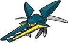
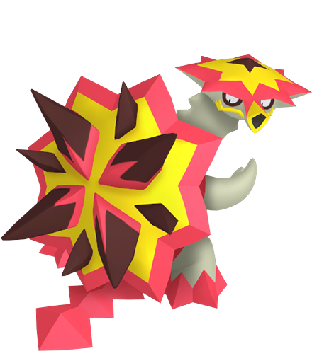

# Pokémon Sun Team

---

## Primarina (Ariopera)

  

### Moves

- Dazzling Gleam (TM99 - Vast Poni Canyon)
- Sparkling Aria (Evolution)
- Ice Beam (TM13 - Mt. Lanakila)
- Psychic (TM29 - Aether Paradise)

### Misc

- **Item:** Mystic Water (Paniola Ranch)  
- **Ability:** Torrent  
- **Nature:**  

---

## Vikavolt (Mjolnirax)

  

### Moves

- Thunderbolt (Evolution)
- Bug Buzz (L31)
- Flash Cannon (TM91 - Seafolk Village)
- Air Slash (Move Reminder - Mt. Lanakila PKMN Center - Heart Scale)

### Misc

- **Item:** Amulet Coin  
- **Ability:** Levitate  
- **Nature**  

---

## Turtonator (Ryujin)

  

### Moves

- Flamethrower (L29 / TM35 - Vast Poni Canyon)
- Dragon Pulse (L41)
- Earthquake (TM26 - Resolution Cave)
- Stone Edge (TM71 - Seafolk Village PokéMart - $30,000)

### Misc

- **Item:**  
- **Ability:** Shell Armor  
- **Nature:**  

---

## Pangoro (Bödvarki)

  

### Moves

- False Swipe (TM 54 - Iki Town)
- Sky Uppercut (L52)
- Bullet Punch (Evolution)
- Poison Jab (TM84 - Route 17/Mt. Lanakila)

### Misc

- **Item:**  
- **Ability:** Iron Fist  
- **Nature:**  

---

## Tsareena (Mokosh)

  

### Moves

- Trop Kick (Evolution)
- Acrobatics (TM62 - Ten Carat Hill/Route 15)
- Low Sweep (TM47 - Konikoni City TM Shop - $10,000)
- Return (TM27 - Malie City)

### Misc

- **Item:** None  
- **Ability:** Queenly Majesty (Oblivious)  
- **Nature:**  

---

## Palossand (Ozymandia)

  

### Moves

- Shadow Ball (L41)
- Earth Power (L47)
- Sludge Bomb (TM36 - Shady House)
- Energy Ball (TM53 - Route 8)

### Misc

- **Item:**  
- **Ability:** Water Compaction  
- **Nature:**  
